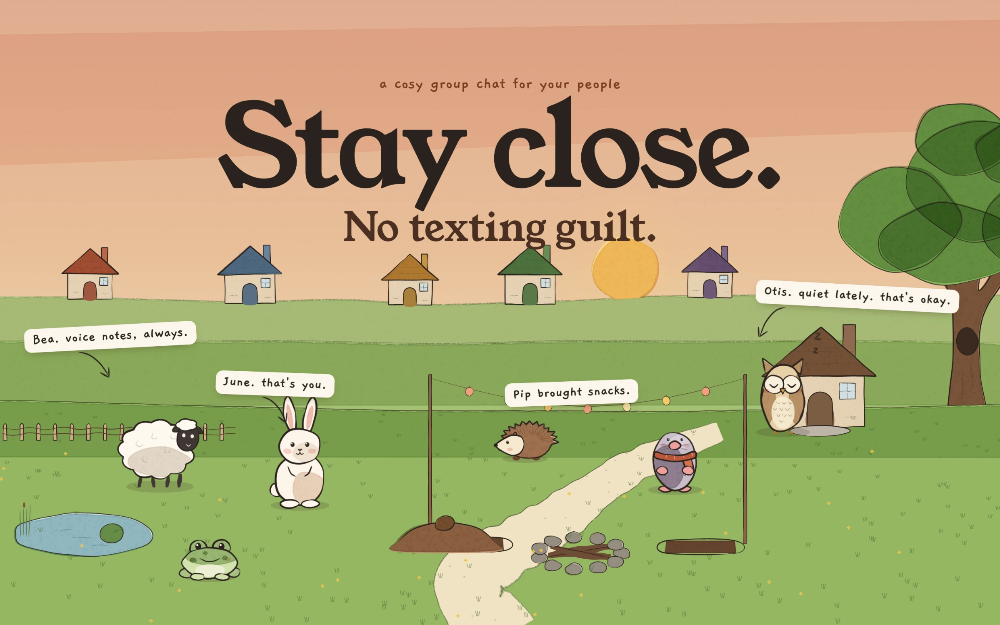
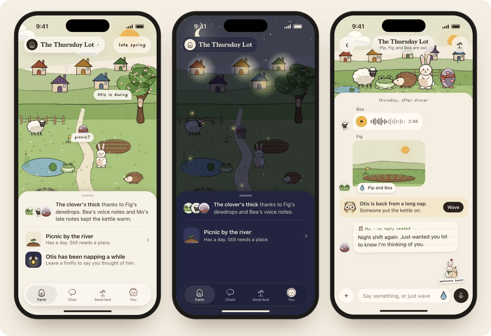
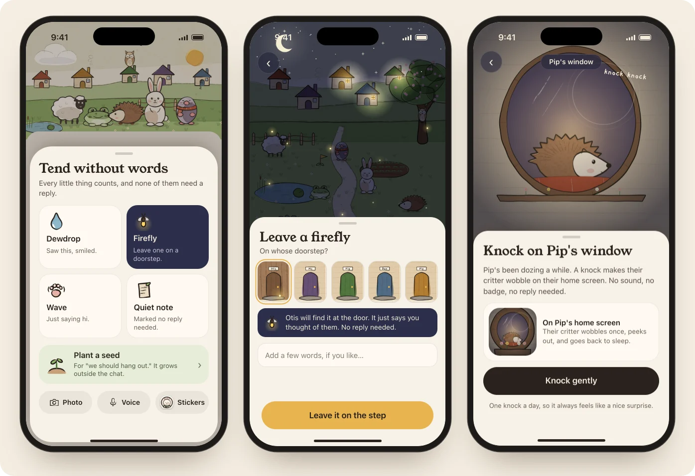
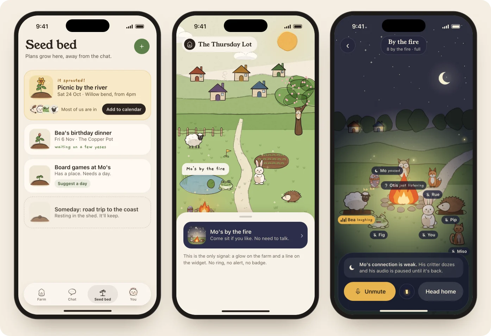
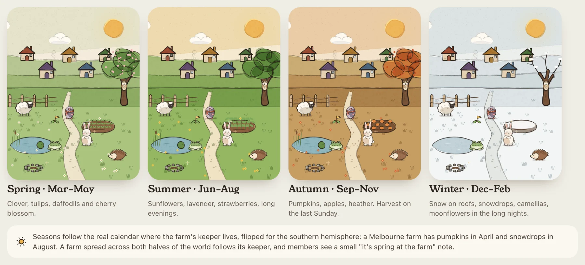
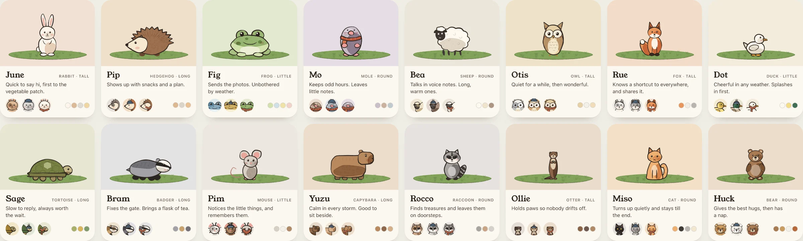
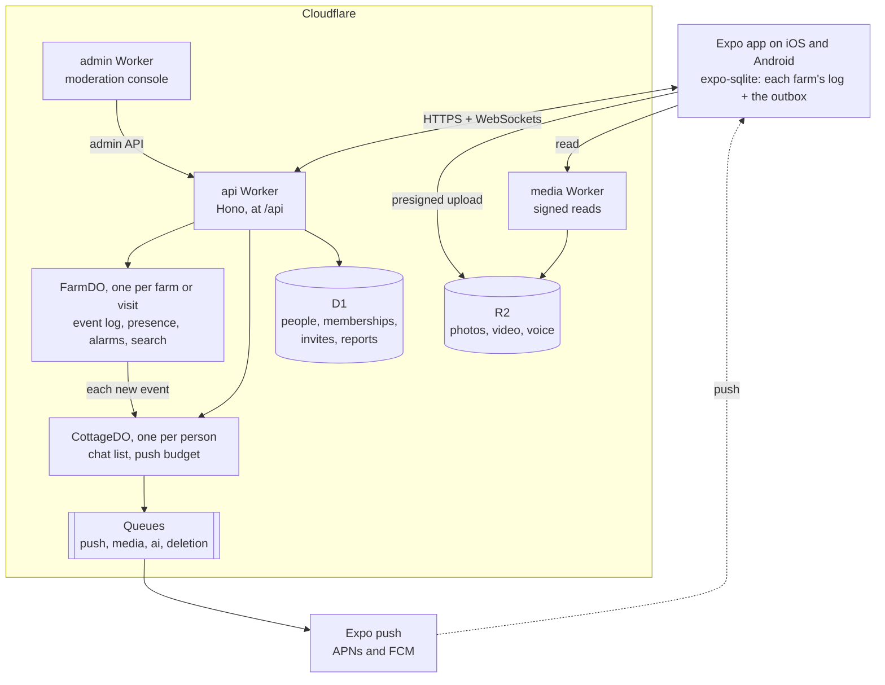
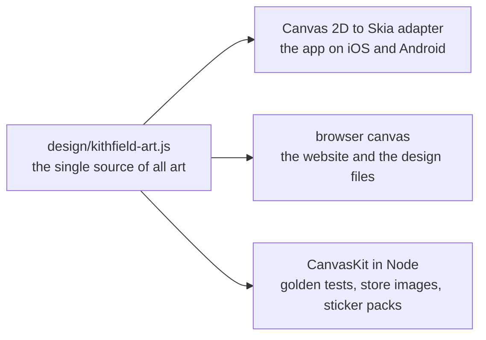

<p align="center">
  
</p>

<h1 align="center">Kithfield</h1>

<p align="center">
  <strong>A cosy group chat for your people.</strong><br>
  Every friend is a critter on a little farm you keep together. No streaks, no guilt, and nothing ever dies.
</p>

<p align="center">
  <a href="https://kithfield.com">kithfield.com</a> ·
  <a href="#what-kithfield-is">What it is</a> ·
  <a href="#the-house-rules">House rules</a> ·
  <a href="#architecture">Architecture</a> ·
  <a href="#getting-started">Getting started</a>
</p>

---

## What Kithfield is

_Kith_ is an old word for friends and neighbours. Kithfield is the field you keep together.

Each friend group gets a **farm**. Everyone on it is a **critter** who lives in their own cottage. The chat sits under the farm, and the farm grows from what friends do there: replies, photos, voice notes, and small gestures that need no answer at all. Quiet friends' critters doze. Nobody keeps count, nothing ever dies, and coming back is always met with a warm welcome.

It is made for the people you love and forget to text back: the friend three time zones away, and the group that has been saying "we should hang out" since March.

> [!NOTE]
> Kithfield is in active development and not yet in the stores. iPhone comes first; Android follows at launch. The designs are finished and the foundations are in place; see [Project status](#project-status).

## Features

### The farm and the chat

<p align="center">
  
</p>

- **Home is the farm.** Cottages, a pond, a seed patch and everyone's critter. The farm reacts live to what friends say, and turns to night after local sunset.
- **A real messaging app underneath.** Replies, @mentions, edits and unsends, pinned messages on the noticeboard, search, voice notes, photos, video, files and link previews.
- **Visits.** One-to-one chats on a porch, kept apart from the group. Each visit grows its own porch pot.
- **A little valley of farms.** Farms and visits live in one list. New activity is a honey dot, never a number.

### Gestures: say hi without words

<p align="center">
  
</p>

- **Dewdrop:** "saw this, smiled". **Firefly:** a thinking-of-you left on a doorstep. **Wave**, and **quiet notes** marked "no reply needed".
- **Knock** on a dozing friend's window, and their critter wobbles once on their home screen. No sound, no badge.
- **Hugs** and warmth for a friend who raised a rain cloud, and **slow post**: your critter carries a letter overnight.
- **Quick Tend** turns a backlog into three gentle cards, with the rest in one bouquet.

### Plans, hangouts and the fire room

<p align="center">
  
</p>

- **Plans grow as seeds.** Every "we should hang out" becomes a seed in the **seed bed**, outside the chat. It sprouts once it has a day, a place and enough yeses. The organiser's hat does the chasing.
- **Hangout day.** On the day, the critters gather at the campfire, and the hangout is pressed into the scrapbook.
- **Sit by the fire.** A drop-in voice room for any farm, shown as critters around the campfire. It never rings anyone; the farm simply glows. **Light your lantern** to turn your camera on.

### Seasons, weather and the field guide

<p align="center">
  
</p>

- **Six kinds of care** (dew, words, pictures, voices, gestures and gatherings) each grow their own plant every season: 24 plants, plus a rose on each birthday and the farm's own signature crop.
- **Real seasons and weather** where the keeper lives, flipped for the southern hemisphere. Rain arrives as rain on the crops.
- **Shared rain** when three or more friends are on the farm at once, and **rare blooms** after it.
- **Harvest day** at the end of each season, and a **field guide** that fills with every plant the farm has grown.

### And the rest

- **Critters.** Sixteen of them, each with its own outline, in many coats, five markings and nine accessories.
- **Stickers.** A free animated pack of your own critter that always wears what your critter has on, together stickers with friends' critters side by side, and export to Messages, Telegram and WhatsApp.
- **On the home screen.** Widgets show the farm at night with a lit window for each friend who is around. Live Activities follow the day of a plan and the fire.
- **Calm by default.** At most one push a day per farm, and nudges back off when ignored. **Hibernate** pauses every nudge everywhere.
- **Safety.** Report and block are one long-press away. Keepers manage their farm. A safety team works from a moderation console, the person who reported hears back, and every removal can be appealed.
- **English and Vietnamese**, written for each language rather than translated word for word, with fonts that carry Vietnamese tone marks.

<p align="center">
  
</p>

## The house rules

Kithfield is built to be put down. These rules are product requirements. A screen or a feature that breaks one is wrong.

| Rule                    | What it means                                                                                                 |
| ----------------------- | ------------------------------------------------------------------------------------------------------------- |
| **No streaks**          | Nothing is lost by being away. Things simply grow a little slower.                                            |
| **No counts of care**   | The farm credits kinds of care and the people who gave it, never totals. New activity is a dot, not a number. |
| **No read receipts**    | "Sent" means delivered, nothing more. No "seen 3 days ago".                                                   |
| **Nothing dies**        | Quiet critters doze and plants rest. Nothing wilts, and no progress is ever taken back.                       |
| **Care is always free** | Chat, gestures, plans, the fire and your own stickers are never behind a paywall.                             |

## Architecture



The art has one source, [`design/kithfield-art.js`](design/kithfield-art.js), drawn once into cached images and moved with transforms. It is never redrawn by hand.



### How sync works

- **The farm keeps the log.** Every write to a farm is one ordered call into its Durable Object, which appends an event with a sequence number. Messages, gestures, plans and everything else are events.
- **The phone keeps a copy.** It stores each farm's events with the last `seq` it has seen, and on reconnect asks for everything after it. A phone far behind gets a snapshot first.
- **Writes go through an outbox.** Each write gets a UUIDv7 `opId` and is retried until the farm answers. The farm applies an `opId` once and answers a duplicate with its original outcome, so retries are safe. A rejected write is answered, never dropped, so the outbox never blocks.
- **One reducer everywhere.** The farm's rules are pure TypeScript in `@kithfield/farm`, run by the server, the app and the widgets. The phone applies its own writes at once through the same reducer, then reconciles when the server's sequence comes back. Randomness is a seeded hash of recorded facts, so every device grows the same farm.

### Workspace

| Path                                       | What it holds                                                                                                                                  |
| ------------------------------------------ | ---------------------------------------------------------------------------------------------------------------------------------------------- |
| [`apps/mobile`](apps/mobile)               | The Expo app for iOS and Android, with dev and prd variants                                                                                    |
| [`apps/api`](apps/api)                     | The API Worker: Hono, the farm and cottage Durable Objects, D1 migrations, queues                                                              |
| [`apps/web`](apps/web)                     | kithfield.com: landing pages, the invite page, legal pages and the waitlist (Astro)                                                            |
| [`apps/admin`](apps/admin)                 | The moderation console's Worker, behind Cloudflare Access                                                                                      |
| [`packages/contracts`](packages/contracts) | The wire contracts as zod schemas: farm events, commands, socket frames, the snapshot and HTTP bodies                                          |
| [`packages/farm`](packages/farm)           | The farm rules as pure TypeScript, and the plant catalogue                                                                                     |
| [`packages/theme`](packages/theme)         | Colour, type, spacing, radii and motion tokens, and the embedded fonts                                                                         |
| [`packages/i18n`](packages/i18n)           | English and Vietnamese copy: one catalogue per feature, the glossary and a completeness test                                                   |
| [`tools/fonts`](tools/fonts)               | Fetches and verifies the embedded fonts, including Vietnamese coverage                                                                         |
| [`tools/readme`](tools/readme)             | Renders this README's images from the design                                                                                                   |
| [`design`](design)                         | The design export: every screen, with notes for the developer, and the art module. Read only; start at [`00 Cover`](design/00%20Cover.dc.html) |
| [`docs`](docs)                             | The decisions behind all of this                                                                                                               |

For depth, read [`docs/tech-decisions.md`](docs/tech-decisions.md) (the shape of the system and the art pipeline), [`docs/backend.md`](docs/backend.md) (the protocol, auth, push, media and moderation) and [`docs/farm-model.md`](docs/farm-model.md) (events, growth, seasons and what sleeps).

## Tech stack

| Layer        | Choice                                                                                                               |
| ------------ | -------------------------------------------------------------------------------------------------------------------- |
| App          | Expo 58, React Native 0.88 (New Architecture, Hermes), Expo Router                                                   |
| Motion       | Reanimated 4 worklets on the UI thread, Gesture Handler 3, expo-haptics                                              |
| Art          | `@shopify/react-native-skia` 2, driven by the design's own art module                                                |
| On the phone | expo-sqlite with SQLCipher: each farm's log and the outbox                                                           |
| API          | Hono 4 on Cloudflare Workers                                                                                         |
| State        | Durable Objects with SQLite storage, D1, R2 and Queues                                                               |
| Auth         | Better Auth: anonymous first, then Sign in with Apple, Google or an email code                                       |
| Contracts    | zod 4 schemas shared by the app and the server                                                                       |
| Website      | Astro, served by Workers static assets                                                                               |
| Later        | LiveKit for the fire room, RevenueCat for purchases, Sentry for errors                                               |
| Tooling      | pnpm workspace with a pinned catalogue, TypeScript 6 strict, ESLint, Prettier, Vitest (packages and API), Jest (app) |

Every shared version is pinned once, in the `catalog:` of [`pnpm-workspace.yaml`](pnpm-workspace.yaml).

## Getting started

### Prerequisites

- Node.js 24 or later.
- pnpm, at the version in `packageManager` in [`package.json`](package.json). `corepack enable` sets it up.
- For the app: macOS with Xcode and an iOS simulator.
- A Cloudflare account only for deploys. Local runs simulate every binding.

### Install and check

```sh
corepack enable
pnpm install

pnpm typecheck                        # every package
pnpm lint
pnpm format:check
pnpm test                             # packages and tools (Vitest)
pnpm --filter @kithfield/api test     # the API, inside the Workers runtime
pnpm --filter @kithfield/mobile test  # the app (Jest)
```

### Run the API locally

```sh
cp apps/api/.dev.vars.example apps/api/.dev.vars
pnpm --filter @kithfield/api dev      # wrangler dev --env dev
curl http://localhost:8787/api/health
# {"status":"ok","environment":"dev","commit":"local"}
```

[`apps/api/.dev.vars.example`](apps/api/.dev.vars.example) lists the names of the local secrets. Values never go in git.

### Run the app on the simulator

```sh
cd apps/mobile
cp .env.example .env                  # APP_VARIANT=dev; set API_BASE=http://localhost:8787/api for a local API
APP_VARIANT=dev pnpm exec expo prebuild -p ios --clean
APP_VARIANT=dev pnpm ios              # builds "Kithfield Dev" and opens it on the simulator
pnpm dev                              # later: start Metro for the dev build
```

`apps/mobile/ios` is generated and ignored. Run the prebuild again after any native change.

### Other tasks

```sh
pnpm --filter @kithfield/web dev      # the website (Astro)
pnpm --filter @kithfield/admin dev    # the moderation console's Worker, on port 8788
pnpm --filter @kithfield/i18n gen     # regenerate the catalogue index after adding a catalogue
pnpm --filter @kithfield/fonts verify # check the embedded fonts against their pinned hashes

pnpm --filter @kithfield/readme exec playwright install chromium
pnpm --filter @kithfield/readme render # re-render this README's images from the design
```

## Project status

Kithfield is being built in five stages. It is planned to open in spring 2027.

| Stage                    | What it covers                                                                                                                                                                | State       |
| ------------------------ | ----------------------------------------------------------------------------------------------------------------------------------------------------------------------------- | ----------- |
| **Foundation**           | The workspace and CI, the wire contracts, theme tokens and fonts, the i18n catalogues, the app and Worker skeletons                                                           | Done        |
| **Engines**              | The art on Skia, the farm reducer, sign-in, the farm object and sync protocol, the cottage and push, the app shell and local data, the website                                | In progress |
| **The core app**         | Onboarding, the farm home, chat, gestures, plans, settings and safety, media, the moderation console. Ends in a first internal TestFlight                                     | Next        |
| **Depth**                | Seasons and the field guide, stickers, the shop and patrons, the fire room, widgets and Live Activities, signature motion, states and accessibility. Ends in an external beta | Planned     |
| **Platforms and launch** | Android, the web and desktop, iPad, store assets, and a hardening pass before the App Store and Google Play                                                                   | Planned     |

## Contributing

Kithfield is not ready for outside contributions yet, but the way it is built is written down. The full working contract is in [`CLAUDE.md`](CLAUDE.md). In short:

- **One branch per change** (`feat/<area>-<behaviour>`), with [conventional commits](https://www.conventionalcommits.org/).
- **The house rules are review criteria.** A change that adds a streak, a count of care, a read receipt, something that dies or care behind a paywall is not merged.
- **Copy only through `@kithfield/i18n`**, in English and Vietnamese, using the glossary's words: farm, critter, visit, keeper, seed bed.
- **Art only from `design/kithfield-art.js`.** It is synced byte for byte and never redrawn.
- **The design is read only.** It is changed in the design project and synced; see [`design/README.md`](design/README.md).
- **Tests where they protect behaviour:** the farm reducer, the protocol and sync, idempotency, auth, purchases, deletion, moderation and the art goldens.

## Licence

The licence is not decided yet. Until it is, all rights are reserved by Odd Eggs Studio. The source is public so you can read it and check that the house rules hold.

The intent ([`docs/tech-decisions.md`](docs/tech-decisions.md) §6) is an app licence that can ship on the App Store, the server under the AGPL, and the art under a separate licence that is not free.

---

<p align="center">
  Made by <a href="https://oddeggs.studio">Odd Eggs Studio</a> · <a href="https://kithfield.com">kithfield.com</a>
</p>
